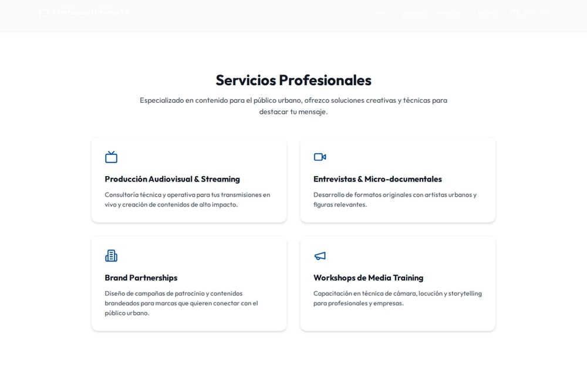
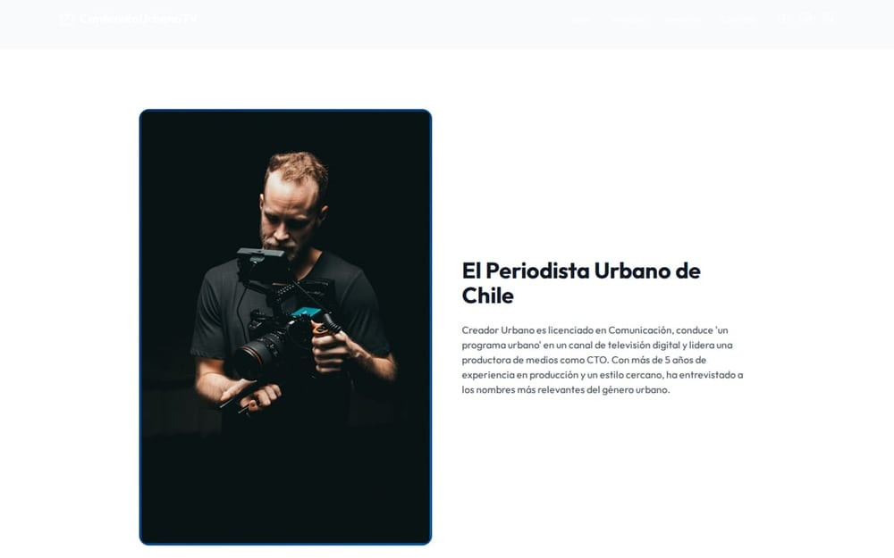
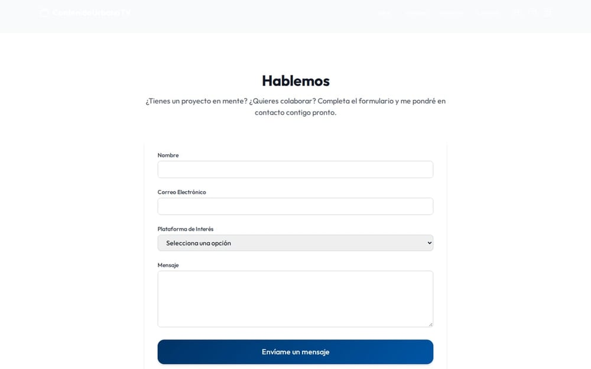
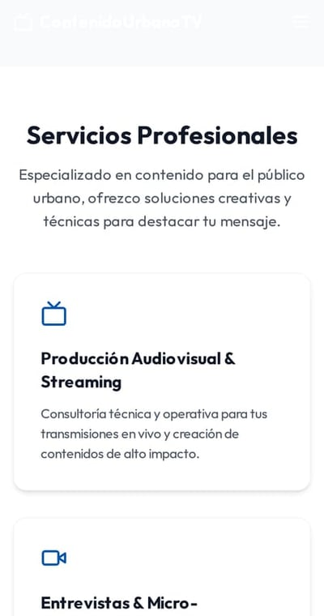
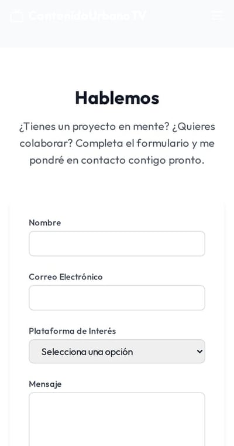

# Contenido Urbano TV — sitio de un creador de contenido

> **Escaparate público.** Versión de portafolio de este producto para demostrar diseño,
> arquitectura y flujos. No incluye código fuente, infraestructura ni credenciales.

Sitio de marca personal para un periodista urbano: presentación, servicios de producción,
carruseles de contenido y captación de colaboraciones. React + Vite + TypeScript.

**Versión:** 1.0.0 · **Año:** 2026 · **Estado:** DEVELOPMENT

## Galería

**Escritorio**

|  <b>Portada</b> |  <b>Servicios</b> |  <b>Nosotros</b> |
|---|---|---|
|  <b>Contacto</b> | &nbsp; | &nbsp; |

**Móvil**

|  <b>Móvil · Portada</b> |  <b>Móvil · Servicios</b> |  <b>Móvil · Contacto</b> |
|---|---|---|

*7 capturas del build real. Cada imagen abre la versión completa; todas están en [`vitrina/screenshots/`](vitrina/screenshots).*

## Documentación

| Documento | Contenido |
|---|---|
| [`vitrina/README.md`](vitrina/README.md) | Presentación, módulos y alcance |
| [`vitrina/docs/ARQUITECTURA.md`](vitrina/docs/ARQUITECTURA.md) | Estructura y decisiones |
| [`vitrina/docs/FUNCIONALIDADES.md`](vitrina/docs/FUNCIONALIDADES.md) | Módulos y para quién existen |
| [`vitrina/docs/FICHA-TECNICA.md`](vitrina/docs/FICHA-TECNICA.md) | Stack, métricas y defectos corregidos |

## Stack

React · TypeScript · Vite · Tailwind · Framer Motion · Swiper

## Alcance

Es una **vitrina**: demuestra diseño y estructura. El formulario valida y confirma en pantalla.

Las capturas se generan automáticamente con Playwright desde el build compilado.

## Contacto

Soluciones Industriales Prime JC — [solinprimejc.com](https://solinprimejc.com)
