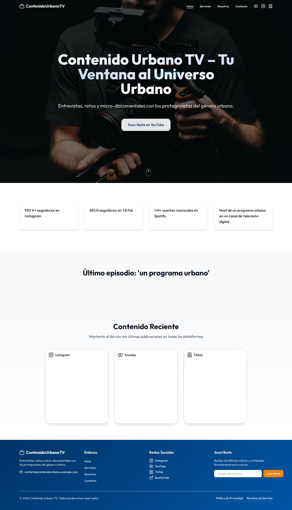
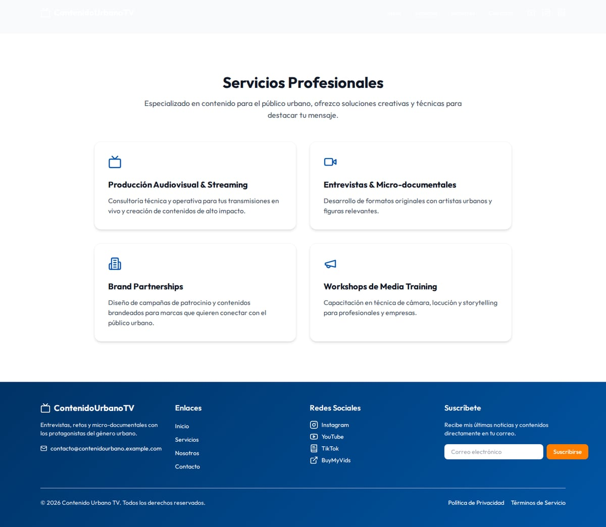
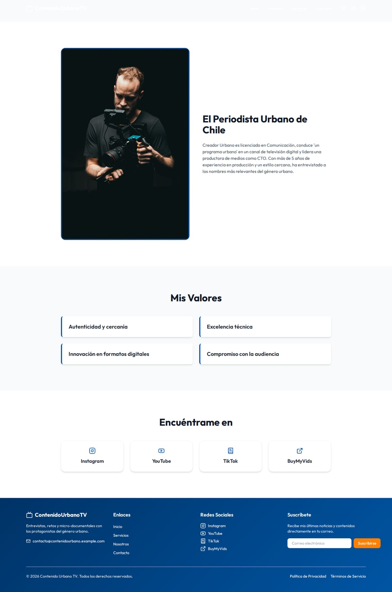
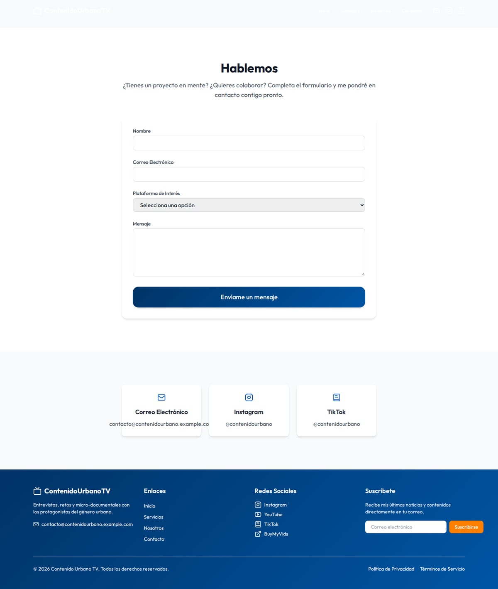
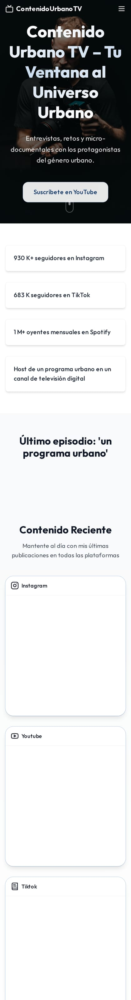
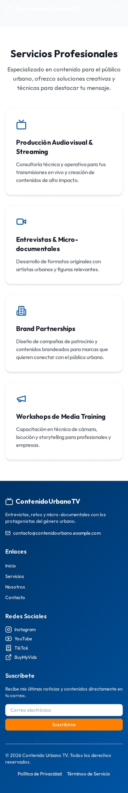
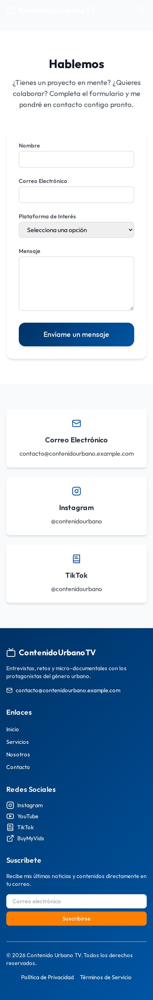
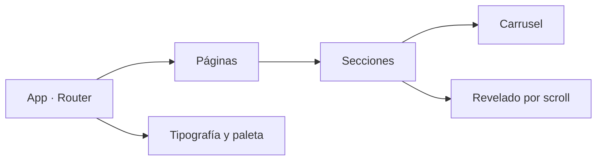

# Contenido Urbano TV — sitio de un creador de contenido

> Escaparate de un sitio personal para un periodista urbano: presentación, servicios de producción,
> carruseles de contenido y captación de colaboraciones. React + Vite, rápido y sin dependencias
> pesadas.

| | |
|---|---|
| **Tipo** | Sitio de marca personal con portafolio y captación |
| **Stack** | React 18 · Vite · TypeScript · Tailwind · Framer Motion · Swiper |
| **Páginas** | 4 rutas |
| **Estado** | Escaparate funcional: compila, renderiza y navega |
| **Alcance** | Demostración. Formularios en modo simulado |

## Qué resuelve

Un creador de contenido vive de que las marcas lo encuentren. Este sitio le da una casa propia, sin
depender del algoritmo de una red social:

1. **Quién es** → presentación directa, sin scroll infinito.
2. **Qué hace** → servicios de producción: entrevistas, documentales, cobertura de eventos.
3. **Prueba** → cifras de audiencia y carrusel de contenido publicado.
4. **Contacto** → formulario y canales directos para propuestas comerciales.

## Capturas

### Portada

### Servicios

### Nosotros

### Contacto

### Móvil
| Portada | Servicios | Contacto |
|---|---|---|
|  |  |  |

## Módulos

| Módulo | Para qué existe |
|---|---|
| **Portada** | propuesta de valor, cifras de audiencia y llamada a suscribirse |
| **Servicios** | qué produce y para quién: entrevistas, retos, micro-documentales |
| **Nosotros** | trayectoria y credibilidad del periodista |
| **Contacto** | propuestas comerciales y colaboraciones |
| **Carruseles** | recorrido del contenido publicado sin salir de la página |
| **Animaciones** | revelado por scroll para dar ritmo sin cargar la página |

## Cómo está construido

- **Componentes por sección**: cada bloque de la portada es independiente y reutilizable.
- **Animación con propósito**: el revelado marca jerarquía, no decora.
- **Sin backend**: el sitio es estático; el contacto se resuelve con enlaces directos.

Detalle en [`docs/ARQUITECTURA.md`](docs/ARQUITECTURA.md),
[`docs/FUNCIONALIDADES.md`](docs/FUNCIONALIDADES.md) y
[`docs/FICHA-TECNICA.md`](docs/FICHA-TECNICA.md).

## Alcance de esta versión

Es una **vitrina**: demuestra diseño y estructura. El formulario valida y confirma en pantalla; no
envía correos.

## Créditos de imágenes

Fotografías de **Pexels**, bajo su [licencia libre](https://www.pexels.com/license/), usadas como
material de demostración.

## Contacto

Soluciones Industriales Prime JC — [solinprimejc.com](https://solinprimejc.com)
